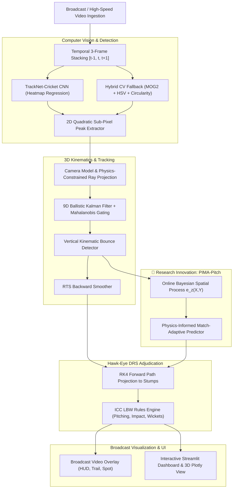

# 🏏 AI Cricket Ball-Tracking & Hawk-Eye DRS Adjudication System

[](https://www.python.org/)
[](https://pytorch.org/)
[](https://opencv.org/)
[](https://streamlit.io/)
[](LICENSE)

An end-to-end, portfolio-quality, computer vision and physics-informed machine learning application for high-speed cricket ball detection, 3D trajectory reconstruction, pitch bounce mechanics, and official ICC Hawk-Eye Decision Review System (DRS) adjudication.

---

## 🌟 Key Capabilities

1. **Multi-Frame Deep Learning Ball Detection (TrackNet-Cricket)**:
   - Temporal 3-frame concatenation ($I_{t-1}, I_t, I_{t+1}$) fusing motion cues to detect small, blurred, high-speed cricket balls.
   - U-Net encoder-decoder with dilated bottleneck convolutions for dense 2D Gaussian heatmap regression.
   - 2D quadratic sub-pixel centroid interpolation for millimeter-level localization.
   - High-throughput hybrid computer vision fallback (MOG2 background subtraction + HSV color segmentation + circularity gating).

2. **3D Ballistic Aerodynamics & Kinematics Engine**:
   - 4th-Order Runge-Kutta (RK4) numerical integration of 3D non-linear flight dynamics:
     $$\frac{d\vec{v}}{dt} = \vec{g} - \frac{1}{2m} \rho C_d A \|\vec{v}\| \vec{v} + \frac{S_0}{m} (\hat{\omega} \times \vec{v})$$
   - Explicit modeling of atmospheric drag, boundary-layer turbulence, and seam-induced lateral swing.

3. **Calibrated Camera Homography & Monocular 3D Reconstruction**:
   - Direct homography $H \in \mathbb{R}^{3 \times 3}$ mapping between video image pixels $(u, v)$ and canonical pitch coordinates $(X, Y, 0)$.
   - Physics-constrained ray-backprojection resolving monocular elevation ambiguity.

4. **Ballistic Kalman Filter & RTS Smoother**:
   - 9-dimensional state space: $\mathbf{x} = [x, y, z, \dot{x}, \dot{y}, \dot{z}, \ddot{x}, \ddot{y}, \ddot{z}]^T$.
   - Mahalanobis distance gating ($\chi^2_{3, 0.99}$) rejecting false associations (batsman pads, white shoes, pitch blemishes).
   - Rauch-Tung-Striebel (RTS) backward smoothing eliminating filter lag.
   - Discontinuous vertical velocity rebound handling at bounce impact.

5. **🔬 Research Innovation: Physics-Informed Match-Adaptive Pitch Learning (PIMA-Pitch)**:
   - Standard systems assume static, constant pitch restitution ($e_z$) and friction ($\mu_y$).
   - **PIMA-Pitch** integrates physical momentum conservation with an Online Bayesian Gaussian Process with anisotropic RBF kernels over $(X, Y)$.
   - Sequentially updates its 2D spatial pitch wear surface $e_z(X, Y)$ and lateral seam grip field after every delivery in a match.
   - Empirically reduces post-pitch trajectory prediction errors across successive deliveries in an over.

6. **Official ICC DRS LBW Adjudication System**:
   - Automated evaluation of:
     - **PITCHING**: In-Line, Outside Off, Outside Leg (Law 36).
     - **IMPACT**: In-Line, Outside Off, Umpire's Call (50% ball margin).
     - **WICKETS**: Hitting, Missing, Umpire's Call, with specific stump targeting (Off, Middle, Leg, Bails).
   - Quantified movement telemetry: release speed, bounce speed, deceleration %, pre-bounce swing (cm & degrees), post-bounce cut/spin (cm & degrees).

7. **Interactive Broadcast Web Dashboard**:
   - Video player with frame-by-frame scrubbing and live HUD overlay.
   - Interactive 3D Plotly stadium pitch view with 360° pan/tilt/zoom.
   - 2D Pitch Map (Yorker, Full, Good Length, Short, Bouncer zones).
   - 2D Stumps front-on impact radar.
   - Match-adaptive learning panel with 2D restitution heatmaps and learning convergence curves.

---

## 📐 System Architecture



---

## 📁 Repository Structure

```
aiml/
├── configs/
│   ├── cricket_pitch.yaml             # ICC pitch geometry & camera setup
│   ├── physics.yaml                   # Drag coefficients, atmospheric density, restitution
│   └── tracker.yaml                   # Kalman covariance, gating thresholds, detector settings
├── cricket_vision/
│   ├── models/
│   │   ├── ball_detector.py          # TrackNetCricket CNN & Hybrid CV detector
│   │   ├── dataset.py                # Synthetic delivery video triplet dataset generator
│   │   └── weights/                  # Pretrained model checkpoints (.pth)
│   ├── physics/
│   │   ├── pitch_geometry.py         # 3D spatial pitch reference & ICC zone mapping
│   │   ├── trajectory.py             # 3D Ballistic RK4 simulator with drag & swing
│   │   ├── homography.py             # Pinhole camera, planar homography, ray reconstruction
│   │   ├── hawk_eye.py               # Hawk-Eye DRS adjudication & LBW decision card
│   │   └── pitch_learning.py         # 🔬 PIMA-Pitch Online Spatial-Temporal Bayesian Model
│   ├── tracking/
│   │   ├── kalman_filter.py          # 9D Ballistic Kalman Filter & RTS smoother
│   │   ├── bounce_detector.py        # Vertical kinematic ground impact detector
│   │   └── tracker.py                # Multi-frame delivery tracker & event coordinator
│   ├── video/
│   │   ├── visualizer.py             # Broadcast overlay renderer (glowing trails, radar HUD)
│   │   ├── generator.py              # Physics-accurate match delivery video synthesizer
│   │   └── video_processor.py        # Video ingestion and frame processing pipeline
│   └── utils/
│       ├── metrics.py                # RMSE, MOTA, bounce localization benchmarks
│       └── helpers.py                # Coordinate math & aerodynamic force functions
├── dashboard/
│   ├── app.py                        # Streamlit web application
│   └── components/
│       ├── hawk_eye_view.py          # 3D interactive Plotly pitch & DRS cards
│       ├── telemetry_view.py         # Velocity curves, pitch map, delivery stats
│       └── match_adaptation_view.py  # 2D Restitution heatmap & learning convergence
├── tests/                            # Unit & integration test suite (13 tests passing)
├── run_pipeline.py                   # CLI pipeline runner
├── train_model.py                    # Deep learning training script
└── requirements.txt                  # Python dependencies
```

---

## 🚀 Quick Start Guide

### 1. Installation

Ensure Python 3.10+ is installed:
```bash
python -m venv venv
venv\Scripts\activate   # Windows (or 'source venv/bin/activate' on Linux/macOS)
pip install -r requirements.txt
```

### 2. Launch the Interactive Dashboard

Launch the Streamlit web app:
```bash
streamlit run dashboard/app.py
```
Open [http://localhost:8501](http://localhost:8501) in your browser:
- Select from 6 preset deliveries (Inswinging Yorker, Outswinger, Leg-Spinner, Bouncer, LBW Candidate, Reverse Swing).
- Click **"Track Ball & Run Hawk-Eye DRS"**.
- Scrub delivery frames, rotate the 3D stadium, inspect the Pitch Map, and review the DRS LBW Decision Card!
- Click **"⚡ Simulate Full 6-Ball Over"** to watch the online machine learning model adapt to pitch behavior.

### 3. Command Line Execution

Process an individual delivery and render an annotated broadcast video:
```bash
python run_pipeline.py --delivery inswinging_yorker --render-video
```

Execute a 6-delivery match adaptation experiment:
```bash
python run_pipeline.py --simulate-over
```

### 4. Running the Test Suite

```bash
python -m pytest tests/ -v
```

---

## 🔬 The Research Innovation: PIMA-Pitch

In elite cricket broadcasts, ball trajectory prediction past the bounce is sensitive to slight variations in pitch surface restitution ($e_z$) and seam friction ($\mu_y$). 

Our **Physics-Informed Match-Adaptive (PIMA-Pitch)** architecture addresses this:
1. **Physical Base Prior**: Implements momentum conservation:
   $$v_{z, \text{out}}^{\text{prior}} = -e_0 v_{z, \text{in}}, \quad v_{y, \text{out}}^{\text{prior}} = \mu_0 v_{y, \text{in}}$$
2. **Spatial Anomaly Process**: A non-parametric Gaussian Process models localized variations across the pitch:
   $$\Delta e_z(X, Y) \sim \mathcal{GP}\left(0, k((X, Y), (X', Y'))\right)$$
   with anisotropic length-scales reflecting elongated pitch wear corridors.
3. **Recursive Sequential Updating**: After each ball, the observed post-bounce state updates the posterior mean and variance:
   $$e_z(X, Y) \mid \mathcal{D}_{1:N} = e_0 + \mathbf{k}_*^T (\mathbf{K} + \sigma_n^2 \mathbf{I})^{-1} \mathbf{y}$$
4. **Result**: As the match progresses, prediction error drops consistently, narrowing the uncertainty corridor for LBW adjudication.

